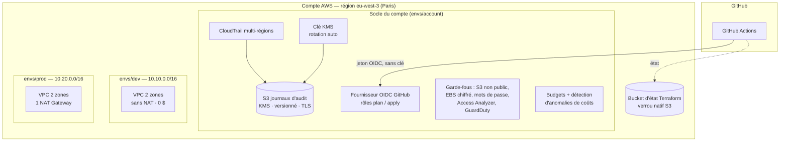
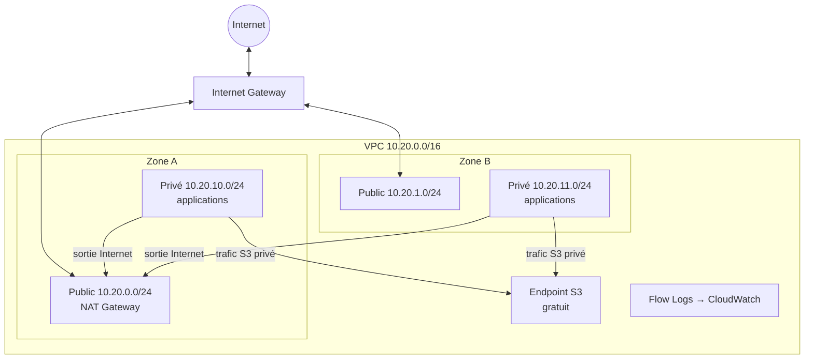
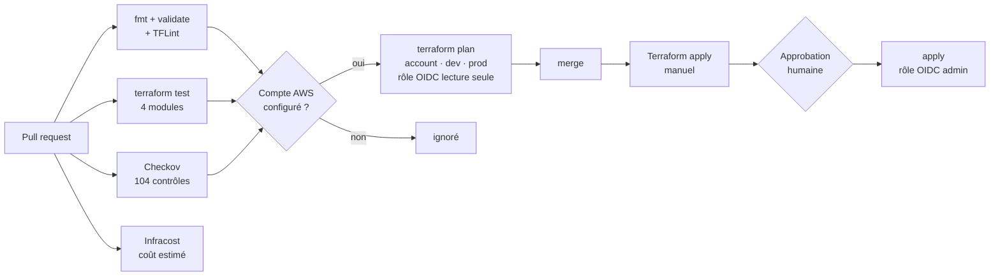

# ☁️ AWS Landing Zone — Terraform

[](https://github.com/Marshall006/aws-landing-zone-terraform/actions/workflows/terraform.yml)


> Le **socle d'un compte AWS** prêt à accueillir des applications, écrit
> entièrement en Terraform : réseau multi-zones, journal d'audit inviolable,
> garde-fous de sécurité, accès de la CI **sans aucune clé stockée** (OIDC),
> budgets et détection d'anomalies de coûts. Le tout est **testé sans compte
> AWS** grâce aux tests Terraform avec fournisseur simulé.

**Compétences démontrées :** Infrastructure as Code (Terraform, modules,
environnements, état distant) · architecture AWS (VPC, IAM, KMS, S3,
CloudTrail) · sécurité cloud (moindre privilège, chiffrement, audit) ·
identité fédérée (GitHub OIDC) · FinOps (budgets, anomalies, étiquetage) ·
tests d'infrastructure (`terraform test`, mock providers) · policy-as-code
(Checkov, TFLint) · CI/CD d'infrastructure avec approbation humaine.

---

## Sommaire

1. [Qu'est-ce qu'une landing zone ?](#-quest-ce-quune-landing-zone-)
2. [Architecture](#️-architecture)
3. [Stack technique détaillée](#-stack-technique-détaillée)
4. [Les modules](#-les-modules)
5. [Sécurité](#-sécurité)
6. [FinOps : maîtrise des coûts](#-finops--maîtrise-des-coûts)
7. [Tester sans compte AWS](#-tester-sans-compte-aws)
8. [CI/CD de l'infrastructure](#-cicd-de-linfrastructure)
9. [Déployer sur ton compte AWS](#-déployer-sur-ton-compte-aws)
10. [Structure du dépôt](#-structure-du-dépôt)
11. [Choix techniques](#-choix-techniques)

---

## 🛬 Qu'est-ce qu'une landing zone ?

Avant de construire une maison, on prépare le terrain : clôture, raccordements,
compteur électrique, plan cadastral. Une **landing zone**, c'est la même chose
pour le cloud : un environnement AWS **sécurisé, tracé et budgété dès le
premier jour**, sur lequel les équipes déploient ensuite leurs applications
sans avoir à réinventer ces fondations.

## 🏗️ Architecture



### Réseau d'un environnement



## 🧰 Stack technique détaillée

| Catégorie | Technologie | Rôle dans le projet | Pourquoi ce choix |
|---|---|---|---|
| **IaC** | **Terraform** 1.13 | Toute l'infrastructure décrite en code | Standard du marché, multi-cloud |
| **Fournisseur** | AWS provider **6.x** | Ressources AWS | Dernière version majeure |
| **État distant** | **S3** + verrou natif (`use_lockfile`) | État partagé, versionné, chiffré | DynamoDB n'est plus nécessaire depuis Terraform 1.10 |
| **Réseau** | VPC, sous-réseaux, IGW, NAT, endpoint S3 | Réseau multi-zones public/privé | Base de toute architecture AWS |
| **Audit** | **CloudTrail** + S3 + **KMS** | Journal de toutes les actions, inviolable | Exigence de toute norme (ISO 27001, SOC 2) |
| **Garde-fous** | S3 Block Public Access, EBS par défaut, IAM, **Access Analyzer**, **GuardDuty** | Sécurité au niveau du compte | Évite les erreurs les plus coûteuses |
| **Identité CI** | **IAM OIDC** + GitHub Actions | Accès temporaire, sans clé stockée | Supprime le risque n°1 : la clé AWS qui fuit |
| **FinOps** | **AWS Budgets**, **Cost Anomaly Detection**, `default_tags` | Alertes de dépenses, étiquetage | Aucune facture surprise |
| **Tests** | **`terraform test`** + `mock_provider` | 23 tests unitaires sans compte AWS | Tests rapides, gratuits, en CI |
| **Lint** | **TFLint** + règles AWS | Erreurs que `validate` laisse passer | Qualité |
| **Sécurité IaC** | **Checkov** | 104 contrôles de sécurité | Exclusions justifiées par écrit |
| **Coûts** | **Infracost** (optionnel) | Coût mensuel estimé à chaque PR | Le coût devient visible avant le déploiement |
| **CI/CD** | **GitHub Actions** | Validation, tests, plan, apply avec approbation | Chaîne complète |

## 🧩 Les modules

| Module | Contenu | Tests |
|---|---|---|
| [`network`](modules/network) | VPC, sous-réseaux publics/privés sur 2-3 zones, NAT configurable (`none` / `single` / `per_az`), endpoint S3, flow logs, groupe de sécurité par défaut verrouillé | 7 |
| [`security-baseline`](modules/security-baseline) | CloudTrail multi-régions chiffré et validé, bucket d'audit (TLS, versioning, cycle de vie), garde-fous du compte, Access Analyzer, GuardDuty optionnel | 5 |
| [`github-oidc`](modules/github-oidc) | Fournisseur OIDC GitHub, rôle `plan` (lecture seule) et rôle `apply` (réservé à l'environnement GitHub protégé) | 4 |
| [`finops`](modules/finops) | Budget mensuel (alertes 50/80/100 % + prévision), détection d'anomalies | 4 |

Les environnements assemblent ces modules :

| Environnement | Contenu | Coût fixe estimé |
|---|---|---|
| `envs/account` | Sécurité, OIDC, budgets (une fois par compte) | ~1 $/mois (clé KMS) + stockage des journaux |
| `envs/dev` | VPC 2 zones, **sans NAT** | ~0 $ (hors trafic et journaux) |
| `envs/prod` | VPC 2 zones, 1 NAT Gateway | ~33 $/mois (NAT) |

Une NAT Gateway coûte environ 0,045 $ de l'heure, soit près de 33 $ par mois,
**même sans trafic**. C'est la ressource la plus souvent oubliée sur une
facture AWS : c'est pourquoi `dev` n'en a pas.

## 🔐 Sécurité

| Contrôle | Mise en œuvre |
|---|---|
| Aucune clé AWS permanente | GitHub OIDC : identifiants temporaires (1 h) liés au dépôt et à la branche |
| Moindre privilège | Rôle `plan` en lecture seule ; rôle `apply` réservé à l'environnement GitHub « production » (approbation humaine) |
| Traçabilité | CloudTrail multi-régions + services globaux (IAM) |
| Intégrité des preuves | Validation des fichiers de journaux + versioning |
| Chiffrement | KMS (rotation automatique) pour l'audit, EBS chiffré par défaut, état chiffré |
| Pas de fuite publique | Blocage des accès publics S3 au niveau du compte et de chaque bucket |
| Transport | Refus de toute requête non TLS sur les buckets |
| Réseau | Sous-réseaux privés sans IP publique, groupe de sécurité par défaut vide, flow logs |

## 💰 FinOps : maîtrise des coûts

- **Budget mensuel** avec e-mails à 50 %, 80 % et 100 % de la dépense réelle,
  et **dès que la prévision** de fin de mois dépasse le budget.
- **Détection d'anomalies** : un pic inhabituel (NAT oubliée, boucle
  infinie…) déclenche une alerte le jour même.
- **Étiquettes obligatoires** sur toutes les ressources (`Project`,
  `Environment`, `Owner`, `CostCenter`) pour savoir qui dépense quoi.
- **Cycle de vie** des journaux : archivage en Glacier après 90 jours,
  suppression après la durée de conservation.
- **Infracost** dans la CI : le coût d'une modification est visible **avant**
  de la déployer.

## 🧪 Tester sans compte AWS

Les tests utilisent `mock_provider` (Terraform ≥ 1.7) : Terraform exécute le
plan et l'application **avec un AWS simulé**, puis vérifie nos règles
d'architecture. Aucune ressource n'est créée, aucun identifiant n'est requis.

```hcl
run "no_nat_by_default_costs_nothing" {
  command = apply  # entièrement simulé
  assert {
    condition     = length(aws_nat_gateway.this) == 0
    error_message = "Par défaut, aucune NAT Gateway (coût fixe ~33 $/mois)."
  }
}
```

Exemples de règles vérifiées : sous-réseaux répartis sur des zones
différentes, aucune IP publique automatique, CloudTrail multi-régions avec
validation d'intégrité, bucket d'audit chiffré KMS et accessible uniquement en
TLS, rôle d'administration réservé à l'environnement protégé, aucun autre dépôt
GitHub autorisé, budget avec alerte prévisionnelle, rejet des valeurs
invalides (CIDR trop petit, mode NAT inconnu, e-mail invalide, dépôt `*`…).

## 🔄 CI/CD de l'infrastructure



## 🚀 Déployer sur ton compte AWS

> 💡 Un nouveau compte AWS reçoit jusqu'à 200 $ de crédits pendant 6 mois
> (*Free plan*). Les seules ressources à coût fixe de ce projet sont la clé KMS
> et la NAT Gateway de `prod`. **Détruis `prod` après chaque session de test.**

**Prérequis :** Terraform ≥ 1.10, AWS CLI configurée (`aws configure` avec un
utilisateur administrateur, **jamais** le compte root).

```bash
# 1. Bucket de l'état Terraform (une seule fois)
make bootstrap

# 2. Socle du compte : copier et remplir les variables
cp envs/account/terraform.tfvars.example envs/account/terraform.tfvars
make init ENV=account && make apply ENV=account
# -> confirmer l'abonnement aux alertes dans l'e-mail reçu d'AWS

# 3. Réseau de dev (gratuit)
make init ENV=dev && make apply ENV=dev

# 4. Nettoyage
make destroy ENV=dev
```

**Activer le plan automatique dans la CI :** dans GitHub, **Settings >
Secrets and variables > Actions > Variables**, créer :

| Variable | Valeur |
|---|---|
| `AWS_PLAN_ROLE_ARN` | sortie `github_plan_role_arn` |
| `AWS_APPLY_ROLE_ARN` | sortie `github_apply_role_arn` |
| `TF_STATE_BUCKET` | nom du bucket créé par `bootstrap` |
| `ALERT_EMAILS` | `["ton.email@example.com"]` |

Puis créer l'environnement **Settings > Environments > production** avec
**Required reviewers** (toi-même).

## 📁 Structure du dépôt

```
aws-landing-zone-terraform/
├── bootstrap/                 # bucket de l'état Terraform (une fois)
├── modules/
│   ├── network/               # VPC multi-zones + tests
│   ├── security-baseline/     # CloudTrail, KMS, garde-fous + tests
│   ├── github-oidc/           # accès CI sans clé + tests
│   └── finops/                # budgets, anomalies + tests
├── envs/
│   ├── account/               # socle du compte
│   ├── dev/                   # réseau sans NAT
│   └── prod/                  # réseau avec NAT
├── .checkov.yaml              # exclusions de sécurité justifiées
├── .tflint.hcl
└── .github/workflows/         # CI (terraform.yml) + déploiement (apply.yml)
```

## 🧠 Choix techniques

| Décision | Alternative écartée | Raison |
|---|---|---|
| GitHub OIDC | Clé d'accès IAM dans les secrets GitHub | Aucune clé permanente à faire fuiter ou à faire tourner |
| Verrou natif S3 (`use_lockfile`) | Table DynamoDB | Plus simple, recommandé depuis Terraform 1.10 |
| Socle du compte séparé des environnements | Tout dans chaque environnement | CloudTrail, OIDC et budgets sont uniques par compte |
| NAT configurable, absente en dev | Une NAT par zone partout | ~33 $/mois par NAT, même inutilisée |
| Endpoint S3 Gateway | Trafic S3 via la NAT | Gratuit, plus sûr, réduit la facture NAT |
| Tests avec `mock_provider` | Tests sur un vrai compte (Terratest) | Gratuits, rapides, exécutables par tous en CI |
| Compte unique | AWS Organizations / Control Tower | Rejoindre Organizations convertit le Free plan en plan payant ; le multi-comptes est l'étape suivante en entreprise |
| Exclusions Checkov documentées | Tout corriger ou tout ignorer | Chaque risque accepté est justifié (coût / bénéfice) |
| Région Paris (eu-west-3) | Cape Town (af-south-1) | Région standard, francophone ; af-south-1 doit être activée manuellement et coûte plus cher |

## 👤 Auteur

**Soumaïla Cissé Piénikoua IDANI** — [GitHub @Marshall006](https://github.com/Marshall006)

Projet 5/6 d'un portfolio **IA / MLOps · Cloud · DevOps** :
[1. MLOps Credit Risk](https://github.com/Marshall006/mlops-credit-risk) ·
[2. RAG Agent](https://github.com/Marshall006/rag-agent-assistant) ·
[3. K8s GitOps Platform](https://github.com/Marshall006/k8s-gitops-platform) ·
[4. DevSecOps Pipeline](https://github.com/Marshall006/devsecops-pipeline) ·
**5. AWS Landing Zone**
